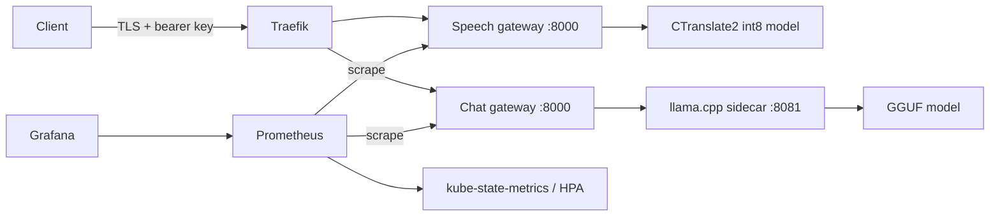

# A cost-aware serving platform for African-language AI

**Measured platform validation:** the one-node AWS experiment scaled from one
replica to two and back, recovered after pod deletion, and was destroyed with
independent resource verification. A short speech workload achieved 0.208
successful requests/s at 3,592 ms p95 and $0.1387 per 1,000 successes. The
two-node comparison is running; final fine-tuned speech integration is pending.

The platform serves a CTranslate2 int8 Yoruba speech model and a GGUF language
model through authenticated FastAPI gateways. Terraform provisions AWS EC2
servers and networking; cloud-init installs pinned k3s. Helm deploys services,
resource limits, probes, HPA and optional TLS ingress. Prometheus/Grafana collect
HTTP metrics, audio seconds, stream duration and replica counts.



```bash
python3.12 -m venv .venv
. .venv/bin/activate
pip install -e '.[dev]'
pytest -q
terraform -chdir=infra init -backend=false
terraform -chdir=infra validate
helm lint k8s/afri-ai
```

Follow [the setup guide](docs/setup.md) for credentials outside the repository,
`terraform apply`, model distribution, monitoring, Helm installation and k6.
The complete experiment has two topologies: one larger node and two smaller
nodes. AWS uses the dedicated `afri-research` profile and free credits. The
account's Free plan rejected `m7i.xlarge`; the eligible experiment uses one
`m7i-flex.large` versus two `c7i-flex.large` nodes. Aggregate RAM is matched,
but the two-node setup has twice the vCPU count. See the explicit hardware and
workload limits in [the measured report](docs/cloud-report.md).

`POST /transcribe` takes a raw WAV/FLAC body and returns text, language and duration:

```bash
curl --fail http://127.0.0.1:8000/transcribe \
  -H "Authorization: Bearer $API_KEY" -H 'Content-Type: audio/wav' --data-binary @sample.wav
```

`GET /health` is liveness; `/ready` checks model availability. Chat uses
`POST /v1/chat/completions`. Metrics and llama.cpp itself are not exposed through
the public ingress. NetworkPolicy denies cross-pod access to the sidecar port.

GitHub Actions validates Python/Terraform/Helm, builds amd64 images for
speech, chat gateway and llama.cpp, then publishes commit-tagged images to GHCR
on pushes. Review the actual Actions run before claiming a registry build passed.

Model artifacts must be present at the configured read-only paths on **every**
node before scaling or rescheduling. Host paths are used for a small research
cluster; there is no claim of automatic model distribution or production storage.
HPA can only schedule replicas that fit the remaining CPU/RAM; maximum replicas
must be chosen against actual cluster capacity.

The completed one-node run has verified teardown evidence under
[`docs/runs/one-node`](docs/runs/one-node). Its speech model is pretrained tiny
int8, pending the fine-tuned Project 1 artifact. An interrupted two-node attempt
was also destroyed and is excluded from comparisons. The finite rerun performs
load, failure and capacity tests, exports monitoring, then destroys resources
in a `finally` block. After any real experiment:

```bash
bash scripts/terraform.sh destroy
bash scripts/terraform.sh state list
```

Save sanitized destroy output and confirm the state list is empty. Check the AWS
console for residual boot volumes and other billable resources. The report must
say **destroy verified** only after this evidence exists. See
[the cost protocol](docs/experiment.md) and [completion record](docs/completion.md).
