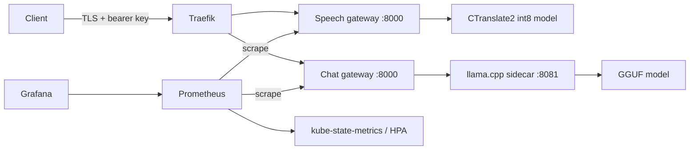

# A cost-aware serving platform for African-language AI

**Status:** services and infrastructure code built; cloud capacity, autoscaling,
failure recovery and cost claims require a deployed measurement run.

The platform serves a CTranslate2 int8 Yoruba speech model and a GGUF language
model through authenticated FastAPI gateways. Terraform provisions AWS EC2
servers and networking; cloud-init installs pinned k3s. Helm deploys services,
resource limits, probes, HPA and optional TLS ingress. Prometheus/Grafana collect
HTTP metrics, audio seconds, stream duration and replica counts.



```bash
python3.12 -m venv .venv
. .venv/bin/activate
pip install -e '.[dev]'
pytest -q
terraform -chdir=infra/aws init -backend=false
terraform -chdir=infra/aws validate
helm lint k8s/afri-ai
```

Follow [the setup guide](docs/setup.md) for credentials outside the repository,
`terraform apply`, model distribution, monitoring, Helm installation and k6.
The complete experiment has two topologies: one larger node and two smaller
nodes. Use only verified free quota or free credits. AWS uses the dedicated `afri-research` profile and free credits. Compare one
`m7i.xlarge` with two `m7i.large` instances for equal total vCPU/RAM. Verify credits
and regional prices before provisioning. An alternative Oracle implementation is
retained under `infra/`; see `docs/setup-oracle.md`.

`POST /transcribe` takes a raw WAV/FLAC body and returns text, language and duration:

```bash
curl --fail http://127.0.0.1:8000/transcribe \
  -H "Authorization: Bearer $API_KEY" -H 'Content-Type: audio/wav' --data-binary @sample.wav
```

`GET /health` is liveness; `/ready` checks model availability. Chat uses
`POST /v1/chat/completions`. Metrics and llama.cpp itself are not exposed through
the public ingress. NetworkPolicy denies cross-pod access to the sidecar port.

GitHub Actions validates Python/Terraform/Helm, builds amd64 and arm64 images for
speech, chat gateway and llama.cpp, then publishes commit-tagged images to GHCR
on pushes. Review the actual Actions run before claiming a registry build passed.

Model artifacts must be present at the configured read-only paths on **every**
node before scaling or rescheduling. Host paths are used for a small research
cluster; there is no claim of automatic model distribution or production storage.
HPA can only schedule replicas that fit the remaining CPU/RAM; maximum replicas
must be chosen against actual cluster capacity.

No cloud resources were provisioned during the initial code build, so no cloud
teardown has occurred or is claimed. After any real experiment:

```bash
bash scripts/terraform.sh destroy
bash scripts/terraform.sh state list
```

Save sanitized destroy output and confirm the state list is empty. Check the AWS
console for residual boot volumes and other billable resources. The report must
say **destroy verified** only after this evidence exists. See
[the cost protocol](docs/experiment.md) and [completion record](docs/completion.md).
