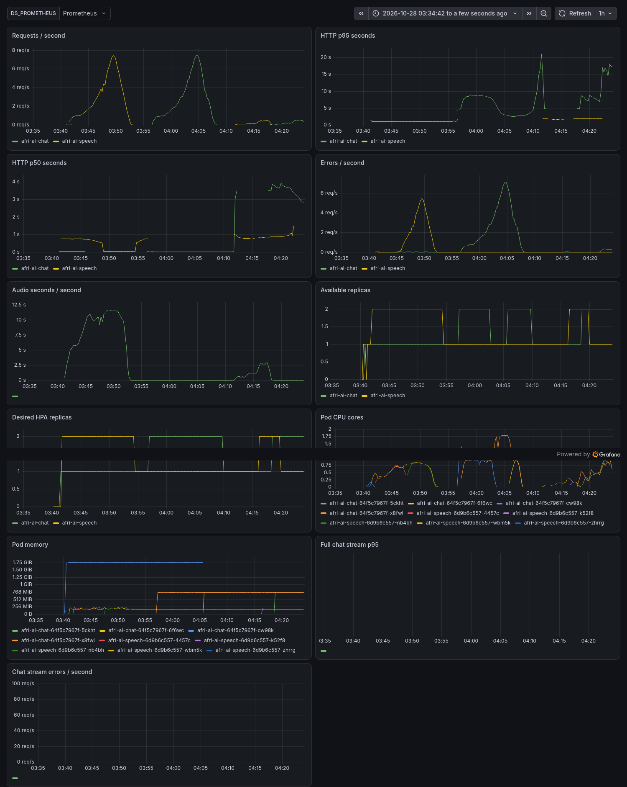
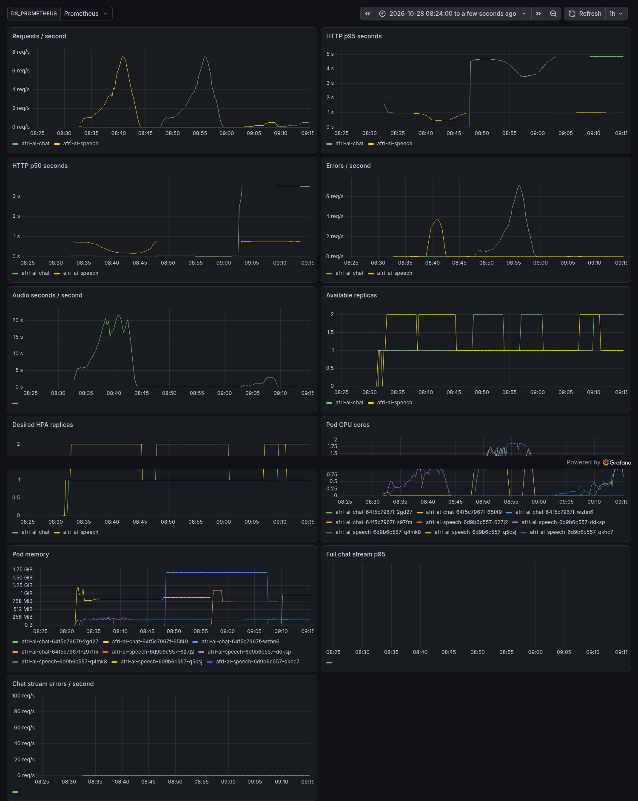

# Selected-model AWS serving validation

Measured research deployment; **production sign-off remains pending**. The selected WAXAL fine-tuned tiny int8 and Qwen2.5-1.5B Q4 models are identified by exact hashes in each run. The source float ASR checkpoint had 88.76% full-test WER in Project 1; consult its compression results for the CPU int8 variant. Serving success does not establish transcription accuracy.

Both topologies use the same source, images and weights. The final gateway admits canonical integer PCM WAV before native parsing. Model init hashes, restricted pod networking with same-node controls, real TLS requests, chart upgrade/rollback, load, failure and teardown are recorded. The private localhost certificate does not establish public-domain TLS renewal.

The workload repeats one real 5.760-second Yoruba recording (SHA256 `306938593445316a5ed515200fc22908d0b2916701f03d1a8e7674597b4b8879`) and, separately, one English two-sentence explanation capped at 64 tokens. Each arrival plateau lasts 120 seconds. This is a short workload sample, not a general capacity or Nigerian-language LLM accuracy claim.

## Lowest measured cost meeting the stated targets

Eligibility requires less than 5% errors, zero dropped arrivals, and successful-response sample p95 at most 30 seconds. All plateaus remain in the accompanying CSV. Stress overload failures and fast 429 responses are retained separately; they cannot count as successful inference throughput.

| Topology | Endpoint | Successes / requests | Successful req/s | Successful p50 ms | Successful p95 ms | Errors | USD / 1,000 successes |
| --- | --- | ---: | ---: | ---: | ---: | ---: | ---: |
| 1xm7i-flex.large | speech | 60 / 61 | 0.500 | 1153 | 1280 | 1.6% | $0.0578 |
| 1xm7i-flex.large | chat | 24 / 25 | 0.200 | 2679 | 7807 | 4.0% | $0.1445 |
| 2xc7i-flex.large | speech | 61 / 61 | 0.508 | 1002 | 1117 | 0.0% | $0.1017 |
| 2xc7i-flex.large | chat | 59 / 60 | 0.492 | 2394 | 2528 | 1.7% | $0.1052 |

Costs allocate the full cluster compute, 30-GB/node gp3 storage and public IPv4 list price to each isolated endpoint workload: `1000 × hourly USD / (3600 × successful req/s)`. Credits do not change list prices. Tax, traffic, setup/idle time, cold starts and mixed-workload amortization are separate; this is not an account billing statement.

## Pod replacement

| Topology | Endpoint | Ready pods before deletion | Replacement ready seconds | Result |
| --- | --- | ---: | ---: | --- |
| 1xm7i-flex.large | speech | 2 | 7.65 | recovered |
| 1xm7i-flex.large | chat | 2 | 186.71 | recovered |
| 2xc7i-flex.large | speech | 2 | 6.29 | recovered |
| 2xc7i-flex.large | chat | 2 | 191.05 | recovered |

Deletion uses the configured graceful termination period. Replacement readiness differs from total outage when another replica continues serving. Saved request, HPA and pod observations establish what occurred; no outage duration is invented.

## Evidence and limits

- [1xm7i-flex.large run manifest](runs/final-one-node-hardened-20261028-r2/run.json), [policy checks](runs/final-one-node-hardened-20261028-r2/network-policy-verification.json), [rollout probe journal](runs/final-one-node-hardened-20261028-r2/smoke-attempts.jsonl), [monitoring export](runs/final-one-node-hardened-20261028-r2/monitoring-series.json), [verified teardown](runs/final-one-node-hardened-20261028-r2/teardown.json).

- [2xc7i-flex.large run manifest](runs/final-two-node-hardened-20261028-r2/run.json), [policy checks](runs/final-two-node-hardened-20261028-r2/network-policy-verification.json), [rollout probe journal](runs/final-two-node-hardened-20261028-r2/smoke-attempts.jsonl), [monitoring export](runs/final-two-node-hardened-20261028-r2/monitoring-series.json), [verified teardown](runs/final-two-node-hardened-20261028-r2/teardown.json).

One m7i-flex.large has 2 vCPU/8 GiB; two c7i-flex.large nodes have 4 vCPU/8 GiB total. RAM is matched, CPU is not, and Flex performance varies. This comparison cannot isolate node count. Both arrangements have a single control plane and host-path models; no control-plane HA or general availability guarantee is established.

The client is a shared development host using administrator-only ingress and SSH forwarding. Application deadlines, concurrency admission and autoscaling affect these measurements. Streaming-only dashboard panels can be empty for the nonstreaming workload.

OS vulnerability and license findings remain recorded in [the security review](security/review-20261028.md). Model quality, broader workloads, operational restoration/key rotation, trusted public TLS and research/human review remain separate release gates. All known resources for these experiments were destroyed and independently checked.
