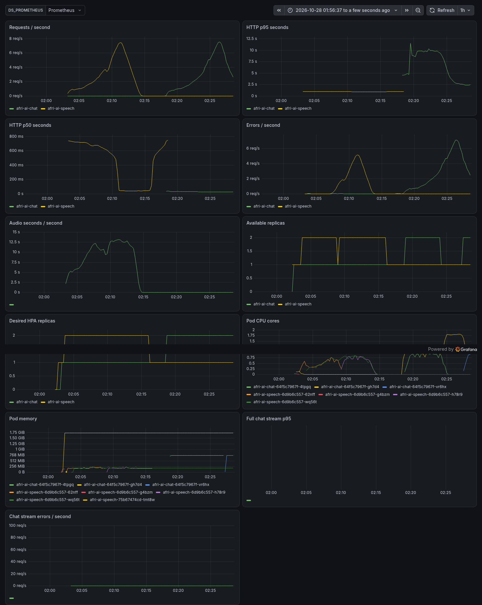

# Selected-model trial before later hardening

Complete one-node measurement at source `a803709561eb70bd5a5de01ecda4bfbe85ccd5dd`. This trial used the selected fine-tuned tiny int8 and Qwen Q4 artifacts. Subsequent PCM admission, network restrictions and notice changes require their separate matching reruns. **This is not production approval or validation of those later changes.**

The workload repeats the real 5.76-second `yor_1374` recording and an English two-sentence answer capped at 64 tokens. Each arrival plateau lasts 120 seconds. Counts include completions in the grace period; small samples and Flex/shared-client variability limit interpretation. Whole-cluster compute/storage/IPv4 list price is allocated to each isolated endpoint. Tax, traffic and setup/idle amortization are separate.

| Endpoint | Offered req/s | Successful / attempted | Successful p95 ms | Errors | USD / 1,000 successes |
| --- | ---: | ---: | ---: | ---: | ---: |
| speech | 0.1 | 12 / 12 | 1179 | 0.0% | $0.2890 |
| speech | 0.2 | 24 / 25 | 1176 | 4.0% | $0.1445 |
| speech | 0.5 | 61 / 61 | 1217 | 0.0% | $0.0569 |
| chat | 0.1 | 12 / 12 | 3216 | 0.0% | $0.2890 |
| chat | 0.2 | 25 / 25 | 3166 | 0.0% | $0.1387 |
| chat | 0.5 | 28 / 61 | 13050 | 54.1% | $0.1239 |

The 0.5 req/s chat plateau has high errors and cannot be used as an eligible low-cost recommendation. Stress-test overload failures remain in the raw metrics. Raw request bodies, API keys and private command logs are excluded.

[All known resources were destroyed and independently checked](teardown.json). `raw-metrics.tar.gz` contains the four original k6 NDJSON files, with no modification to their records. The source ASR checkpoint had 88.76% WER before conversion in Project 1; these serving checks do not establish recognition quality.
